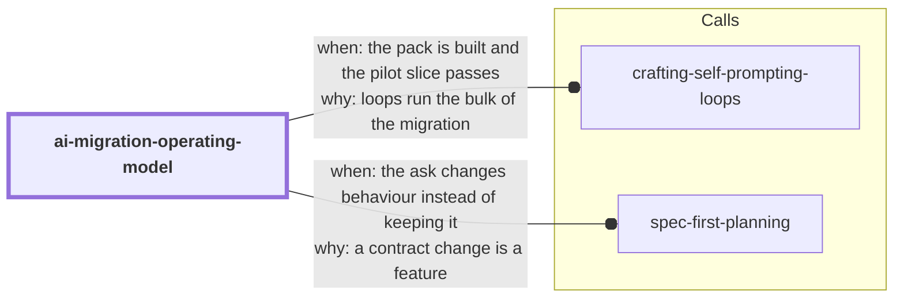

# ai-migration-operating-model

Run an AI-assisted code migration as an **operating model** — rulebook + queues +
reviewers + objective verification — instead of asking agents to "carefully rewrite a
lot of code". The premise: AI makes big migrations cheaper *only* when the migration has
strong control loops and mechanical verification; without them, agents produce
plausible-looking code fast, which is dangerous. The agents are not the strategy — the
loop is.

<!-- skill-graph:start -->
## Where it fits

<!-- Generated by scripts/gates/skill_graph.py from docs/skill-graph/graph.json. Do not edit this block by hand: edit the JSON, then run `make skill-graph`. -->

**Start here if** you want to port, upgrade or rewrite a service.



An arrow from A to B means A sends work or data to B. `==>` contract envelope, `-->` required, `--o` handoff (you start the next skill), `-.->` optional (only when installed). The map of all skills is in the [root README](../README.md#how-the-skills-fit-together).
<!-- skill-graph:end -->

## What it does

1. **Qualifies the candidate** against a decision table (measurable pain? capturable
   behavior? bounded scope? cheap rollback?) — and is happy to answer "don't migrate
   yet, do this precursor work first".
2. **Builds the judge first**: golden scenarios from the old system plus a shipped
   parity differ, proven able to catch a deliberately broken case.
3. **Authors a Migration Control Pack** — `RULEBOOK.md`, `DEPENDENCY_MAP.md`,
   `GAP_INVENTORY.md`, `PORTABILITY_TEST_PLAN.md`, `parity_check.*`,
   `AGENT_WORK_QUEUE.md`, `REVIEWER_PROMPTS.md`, `PHASE_GATES.md` — and lints it
   mechanically until clean.
4. **Pilots on a disposable slice**, folding every lesson back into the rulebook, then
   fans out implementer/reviewer agents under phase gates. Batch defects are fixed by
   updating the rule and regenerating — never by hand-patching fifty files.

## Four invocations, one per part of the model

Invoke bare for the full workflow, or pass a mode to run one part standalone
(mirroring the operating model's four parts):

| Invocation | Part | Deliverable |
|---|---|---|
| `economics [target]` | Why AI changes migration economics | Brief: measurable pain, what agent leverage changes here, honest cost frame, does the pain clear the bar |
| `judge [target]` | Verification is the foundation | Golden scenarios + parity runner, proven to catch a seeded break |
| `pack [target]` | The migration control pack | The eight artifacts, linted to `PACK_RESULT: PASS` |
| `qualify [target]` | Candidate filter | Row-by-row go / no-go / precursor-work verdict |

## Shipped tooling (stdlib-only, offline)

| Tool | Job |
|---|---|
| `assets/control_pack_lint.py` | Deterministic linter for the Control Pack: required artifacts, sequential `MR`/`G`/`S` ids, binding modals, machine-readable queue statuses, judge-first phase gates. Prints `PACK_RESULT: PASS\|FAIL`. |
| `assets/parity_diff.py` | The mechanical judge: normalizes and diffs old-vs-new JSON outputs (single case or golden-corpus directories), with `--ignore` for noise keys and `--tolerance` for float drift. Prints `PARITY_RESULT: PASS\|FAIL`. |

## Install

```bash
npx skills add dhanesh/agent-skills --skill ai-migration-operating-model
```

## Layout

- `SKILL.md` — the agent-facing prompt (doctrine, 7-step workflow, deliverable, boundaries)
- `references/control-pack.md` — artifact-by-artifact grammar of the Control Pack
- `references/candidate-filter.md` — the go / no-go decision table
- `references/pilot-playbook.md` — disposable pilot, fan-out mechanics, "fix the loop, not the files"
- `assets/` — the two tools above plus their unit suites (`test_*.py`)
- `eval/run_eval.py` — deterministic outcome eval (gate-run; see `docs/eval-standard.md`)

## Sibling skills

- `spec-first-planning` — when the ask is *new* behavior, not preserved behavior
- `crafting-self-prompting-loops` — builds the execution loops that consume the pack

## Changes

- **1.0.3.** SKILL.md says how to find Python when `python3` is missing, too old or the macOS install stub.
