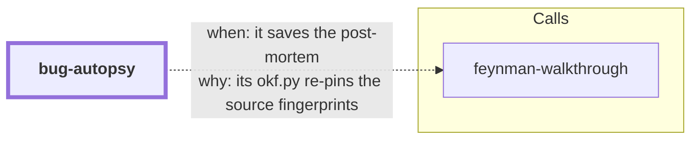

# bug-autopsy

`feynman-walkthrough`'s sibling for failures. Given a defect or incident that already
happened, it traces the failure end-to-end — trigger → propagation → detection → fix —
and captures a **blameless post-mortem** the next engineer can learn from: timeline
reconstructed from evidence (git history, logs, CI runs, issue threads; every entry
cited, inference labeled as inference), root cause chased with a disciplined 5-Whys
chain that stops at a systemic cause rather than a person, and prevention items phrased
as checkboxes someone can actually tick off.

The result is persisted as a `Postmortem` concept in the same Open Knowledge Format
(OKF) bundle `feynman-walkthrough` maintains, so failure knowledge lives next to the
system knowledge, travels with the repo, and stays auditable across sessions.

**Boundaries:** it explains failures that already happened — not live debugging or
on-call triage of a still-burning incident (stabilize first, autopsy after), not
understanding a healthy system (`feynman-walkthrough`), not auditing a codebase's
claims (`base-in-reality`).

<!-- skill-graph:start -->
## Where it fits

<!-- Generated by scripts/gates/skill_graph.py from docs/skill-graph/graph.json. Do not edit this block by hand: edit the JSON, then run `make skill-graph`. -->

**Start here if** you want a post-mortem of one failure.



An arrow from A to B means A sends work or data to B. `==>` contract envelope, `-->` required, `--o` handoff (you start the next skill), `-.->` optional (only when installed). The map of all skills is in the [root README](../README.md#how-the-skills-fit-together).
<!-- skill-graph:end -->

## Install

```bash
npx skills add dhanesh/agent-skills --skill bug-autopsy
```

## Usage

Ask the agent to post-mortem a failure — "autopsy the cache regression", "write up why
last week's outage happened", "post-mortem bug #4821". The workflow:

1. Scope: what failed, blast radius, what the understanding is for (fix, prevent,
   teach).
2. Reconstruct the timeline from evidence, every entry timestamped and cited.
3. Chase root cause with a 5-Whys chain (≥3 levels, each evidenced, blameless).
4. Write the post-mortem from the shipped template.
5. Lint it and repair until clean:

   ```bash
   python3 assets/postmortem_lint.py path/to/postmortem.md
   ```

6. Persist it into the OKF knowledge bundle and re-pin source fingerprints.

The linter is deterministic and stdlib-only: it enforces the required sections
(Summary, Impact, Timeline, Root cause, Contributing factors, Fix, Prevention, Links),
timestamps on every timeline entry, a whys chain at least three levels deep, and
checkbox-style prevention items; blame-y phrasing ("human error", "should have known")
is flagged as a warning to reframe.

## Layout

- `SKILL.md` — the autopsy prompt: ground rules (evidence discipline, blamelessness,
  boundaries), the six-step workflow, the deliverable contract, cross-session revisits.
- `references/postmortem-template.md` — the fillable post-mortem template, with the OKF
  `Postmortem` concept frontmatter at the top.
- `references/five-whys.md` — running the whys chain well: mechanics, where to stop,
  and the person-shaped-answer → system-question translation table.
- `assets/postmortem_lint.py` (+ `test_postmortem_lint.py`) — the structural linter,
  stdlib-only, offline, deterministic.
- `eval/run_eval.py` — outcome eval per the repo standard: known-good and known-bad
  fixture post-mortems through the linter, plus a filled-template usability check.
