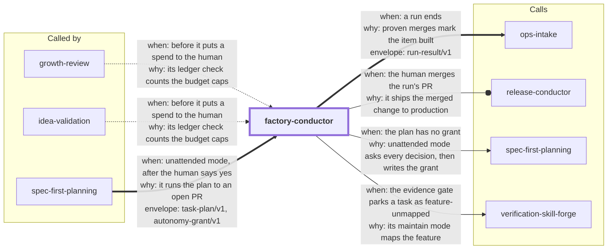

# factory-conductor

Run an approved task plan **unattended**, from its first task to an open pull request, inside
an autonomy grant the user already said yes to. The agent session is the conductor: it
dispatches a fresh executor subagent per task and a fresh reviewer per finished task, and it
drives `assets/conductor.py`, a stdlib state tool that decides what is ready, re-runs every
task's own checks as the proof, merges only what passed both the checks and the review, enforces
the budgets, and records every step in a local append-only log. The run ends with a
`run-result/v1` envelope, a pushed run branch and an open PR. Merging that PR stays with you.

This is step 4 of the collection's [software factory](../README.md#software-factory):
`spec-first-planning` writes the spec, the plan and the grant; this skill builds the plan.

<!-- skill-graph:start -->
## Where it fits

<!-- Generated by scripts/gates/skill_graph.py from docs/skill-graph/graph.json. Do not edit this block by hand: edit the JSON, then run `make skill-graph`. -->

**Usually called by** `spec-first-planning`. `growth-review` and `idea-validation` also use it when it is installed. You can also start it yourself when you have an approved plan and a grant, and want it built to a PR.



An arrow from A to B means A sends work or data to B. `==>` contract envelope, `-->` required, `--o` handoff (you start the next skill), `-.->` optional (only when installed). The map of all skills is in the [root README](../README.md#how-the-skills-fit-together).
<!-- skill-graph:end -->
**1.5.3.** A run that reaches a paid step gives the human a spend request. The controller runs the ledger check from the repository root, then parks only that task with a one-line request. The human buys, then records or withdraws it. No code moves money. The ledger commands are unchanged.

**1.5.2.** SKILL.md says how to find Python when `python3` is missing, too old or the macOS install stub.

**1.5.1.** The contract checker honours `SKILL_PYTHON` (after `SKILL_CONTRACT_PYTHON`) and skips the macOS `python3` install stub without running it.

## Install

```bash
npx skills add dhanesh/agent-skills --skill factory-conductor
```

Install it next to `spec-first-planning`, which produces what it consumes. The conductor
needs macOS or Linux; it does not start on Windows.

## Usage

1. Plan with `spec-first-planning` in unattended mode. It writes a `task-plan/v1` envelope
   and, after your explicit yes, an `autonomy-grant/v1` covering `local_reversible` (and
   `push_branch` and `open_pr` if you want the run to reach a PR). End every acceptance
   criterion in the spec with `[cmd: <argv>]`, the command that proves it: that becomes the
   task's verify command (unattended mode requires one, and `conductor init` refuses a plan
   with a missing command). Commands must use `{python}`, not `python3`, and no absolute
   paths.
2. Switch to a branch the grant covers that is not the default branch and not the run branch
   the conductor will create (`factory/<plan-slug>`, from the plan title), for example
   `factory/work`, and push it: `git push -u origin factory/work`. The PR the run opens
   targets that branch, and the conductor pushes only its own run branch (`init` warns when
   `origin` has no copy of the base).
3. Ask the agent to "run the plan unattended". It runs `conductor init`, then loops
   `next` → `start` → executor → `verify` → reviewer → `review` → `merge` until `next` stops,
   then `finish`.
4. Read the run report: proven tasks with merge commits, parked tasks with reasons or the
   questions they need you to answer, blocked tasks, the stop reason and the budget spent.

**Scheduled re-entry (optional).** If you answer the planner's re-entry question, the grant
carries a `reentry` block with your own agent command (an argv list with `{prompt}`, never a
shell). The conductor then runs `conductor reentry install`, and a timer on this machine
(launchd, a systemd user timer, or cron) calls `conductor watch` every `interval_min`. If
the session dies, `watch` starts your agent with a fixed resume prompt, once the run has been
idle for `stall_min`, at most `max_reentries` times, and never while a live session drives
it, the run waits on you, or the grant no longer covers it. A run lock and a lease keep two
drivers from writing at once. `conductor reentry status` shows the timer and the attempts;
`conductor reentry uninstall` removes the timer, and a finished run removes its own.

**Use an always-on host for re-entry.** The timer can restart a stalled run only while the
machine is on and awake. So run the factory on an always-on Mac or home server, or keep a
laptop plugged in and awake (`caffeinate -s`, or `sudo pmset -c sleep 0` for the charger).
On Linux, install picks a systemd user timer when one works and cron otherwise. For the
systemd timer, turn on lingering (`loginctl enable-linger`). Start the run on
that host and install the timer there. The run state lives in the git-ignored
`.skill-contract/runs/` directory of the machine that started the run, so a timer on
another machine cannot resume it. The steps are in `references/run-protocol.md`, under
"Run on an always-on host".

You can stop a run at any time by revoking the grant
(`contract_check.py revoke-grant --root <repo>`): the next gate asks and the run stops.

**Money ledger (new in 1.5.0, optional).** Commit a monthly budget at `budget/budget.md`: a
`currency:` line and a table of `category | monthly_cap` rows plus a `total` row. Register it
yourself with `python3 <skill dir>/assets/ledger.py register --by <your name>`. Before the agent proposes
any spend to you (hosting, domains, APIs, ads, subscriptions), it runs `ledger.py check`. The
check can refuse a proposal that would break a cap, and a proposal it does not refuse
reserves its amount. It never approves: the pass line is `NOT_REFUSED: <id> — the human's
approval is still required`, and you still decide every spend. You record real spend with
`ledger.py record --by <your name>` and withdraw a proposal with `ledger.py withdraw`.
`ledger.py status` shows caps, spend, reservations and headroom for a month. The format and
every command are in `references/ledger.md`. A project without the budget file sees no change.

## What it enforces, and what it does not

- **Cost is always bounded, by dispatches and by wall clock.** Dispatches (executor, repair and
  reviewer, as the tool records them) are always capped: when the grant and `init --budget`
  set no `max_dispatches`, `init` derives tasks × 2 × (1 + `max_repairs_per_task`), one
  executor and one reviewer per attempt (tasks × 3 × (1 + `max_repairs_per_task`) under the
  evidence gate, which adds a verifier), and `status` shows it as derived. Each dispatch
  `resume` asks for after a crash counts too. The wall clock is capped by `wall_clock_min`
  when set, and always by the grant's expiry: at most 7 days from the newest grant covering
  the plan. Repairs per task (2 by default) and parallelism (2 by default) are enforced too.
  `--budget` can only tighten a limit the grant sets; with no grant cap it can set a higher
  `max_dispatches` than the derived one.
- **Token and dollar caps are opt-in:** `max_tokens` and `max_usd` are recorded. They are
  enforced only when the grant's budget sets `enforce` (`["tokens"]`, `["usd"]` or both). The
  runtime does not expose usage to the tool, so the agent reports each finished dispatch's
  usage with `conductor usage`, as its harness shows it. The run stops at the cap
  (`budget_tokens`, `budget_usd`), and it stops when a finished dispatch has no report
  (`budget_unmetered`). After a stop, a task in flight gets no more repairs: it parks, and
  the run goes past the stop by at most two dispatches per task in flight (the current
  reviewer and verifier). Claude Code shows tokens, not dollars, so an enforced dollar cap
  needs a user's transform (`conductor usage --file`) or a harness that reports cost. The
  totals are claimed, so a cap is only as good as the reports.
  Without `enforce`, dispatch count is the real cost limit. The grant's `stop_on` list is
  recorded too, but not enforced: the conductor's own stop rules apply.
- **The proof is only as good as the checks.** The conductor proves that a task's verify
  commands passed on that task's own commit, before it was merged. Then, before the push,
  `finish` re-runs every proven task's checks on the merged run branch: two tasks that each
  pass alone but break each other once merged stop the run (`integration_red`), and that run
  branch is never pushed. The push sends exactly the commit that re-run verified, and a run
  branch that moved after it is not pushed. The re-run executes your code, so it waits for a
  covering grant: if the grant lapsed, it is skipped and nothing is pushed until you renew
  the grant and run `finish --retry-remote`. CI on the pushed branch is still the independent
  check outside your machine, and the independent reviewer looks past weak checks.
- **A crash does not strand a run.** A new session with no memory of it runs
  `conductor resume`, which prints the exact next step for every in-flight task
  (`NEXT: T2 dispatch-reviewer <sha>`, `NEXT: run finish`, …). Each dispatch it asks for
  spends one from the cap, and when the grant has lapsed it says `NEXT: run ask`: the run
  waits for you to renew the grant rather than ending itself. On a finished run it says
  whether a push or PR is still pending (`run finish`) or nothing is left (`run done`).
- **Re-entry is local, not hosted.** The timer runs on this machine, only while it is on and
  you are logged in (a systemd user timer needs `loginctl enable-linger` to survive logout;
  the conductor needs macOS or Linux and does not start on Windows), and the agent it starts
  has your permissions. A session that is
  alive but idle past `stall_min`, with no conductor call, no worktree change and, under the
  evidence gate, no new verifier record, can get a second driver: the run lock keeps the record intact, and the dispatch cap bounds the waste.
- **Green is not safe: the evidence gate.** When the plan declares a verify skill (a
  `verification` block; spec-first-planning writes it, verification-skill-forge generates
  the skill), a task merges only after `conductor evidence` passes its verified head: a
  verifier other than the owner recorded at `start` drove the running app and recorded
  `.verify/<instance>/<feature>/<sha>/evidence.json` for every touched feature (declared,
  plus every feature whose source anchor the diff touches), bound to that exact commit,
  with intact artifacts and a green doctor. Stale-SHA, forged-SHA, writer-verified,
  doctor-red, unmapped-feature and missing-artifact evidence is rejected, `merge` re-reads
  the records and re-checks the grant, and a commit after the verdict forces a new proof.
  Identities are the agent ids the conductor session passes, so writer ≠ verifier holds as
  far as that session is honest; the same-user residuals below still apply. A plan without
  the block runs as before, and `status` says `evidence_gate=off`.
- **Fan-out is partitioned first.** `init` records which tasks may run side by side before
  anything is dispatched: tasks that share files or a feature, or, under the gate, whose
  files are unknown, run one after the other. `conductor trail` prints the per-task
  decision trail (owner, worktree, verified commit, reviewer, verdict agent, evidence,
  merge outcome).
- **Claims, not proof, to a receiver.** The run result's assertions read as CLAIMED to anyone
  else until they re-run them (`check-envelope --rerun`) or CI on the pushed branch reports them.
- **The money ledger only refuses.** `ledger.py check` refuses a proposal over a category or
  total cap (recorded spend plus open reservations plus the proposal, in each month it
  covers), in another currency, for an unknown category, for a past month, or while the
  budget differs from the registered copy (fail closed). A re-run of the same proposal is
  checked against the caps again, so a cap cut or a new record can refuse it. It never prints
  an approval word and writes no envelope, and `conductor.py` does not read it, so no grant or
  run can take a check as permission: `spend` stays an action class no grant covers. Its
  limits: recorded spend is a claim, `--by` names are self-declared (an agent name or an
  approval word in one is refused), the committed budget shows your caps to anyone who can
  read the repository, spend that nobody records is invisible to it, and its state digest has
  no key, so a consistent hand edit of both state files is not detected. The test-only
  `--today` switch needs `LEDGER_TEST_CLOCK=1`, which only the tests and the eval set.
- **Same-user residuals.** A hostile executor running as your OS user could forge the run's
  state or log, tamper with the git object store, read files outside the verify checkout by
  absolute path, leave a process running past a verify, or redirect where a push goes through
  git config. The reviewer, CI on the pushed branch and your own merge are the defence.

## Layout

- `SKILL.md` — the agent-facing run protocol: preconditions, the loop, the executor and
  reviewer briefs, stop and park rules, and the skill-contract block.
- `references/run-protocol.md` — every `conductor.py` command with its output and exit codes,
  the state and log formats, resume, and a worked three-task example.
- `references/ledger.md` — the budget format and every `ledger.py` command, with its output
  and exit codes.
- `assets/conductor.py` — the state tool; `assets/reentry.py` — the run lock, the lease and
  the `watch` decision; `assets/reentry_timer.py` — the launchd, systemd and cron timers;
  `assets/contract_check.py` — the vendored
  skill-contract checker; `assets/schemas/run-result.v1.json` — the payload schema;
  `assets/test_conductor_*.py` — the stdlib test suites; `assets/ledger.py` — the money
  ledger, with `assets/ledger_testkit.py` and `assets/test_ledger*.py`.
- `eval/run_eval.py` — the outcome eval (see the repo's docs/eval-standard.md).
