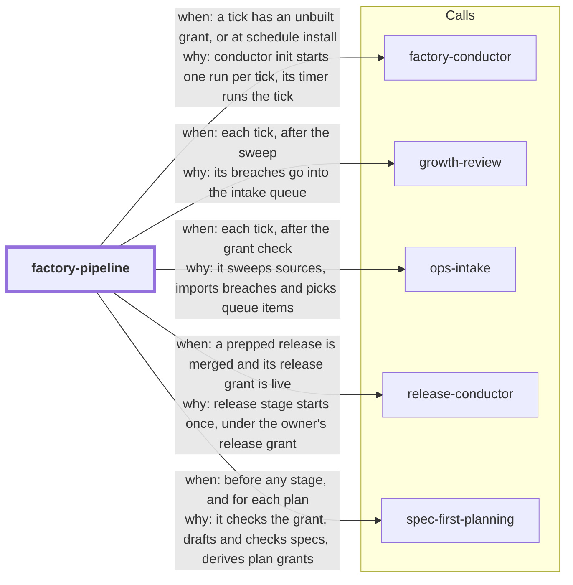

# factory-pipeline

**Status: partly built.** `pipeline tick` ships. Three of its nine stages are not built
yet.

This skill is the scheduled driver of the software factory. One `pipeline tick` runs each
factory stage in order: sweep, growth review, idea follow-up, autopick, plan, derive
grant, build, release stage and digest. It prints one `STAGE: <name> <result>` line for
each stage. Each stage calls the tool of the skill that owns it. The tick uses no shell.

What runs today:

- Only one tick runs at a time in one repository (R14). The tick first takes a
  non-blocking lock on `.skill-contract/pipeline/.lock`. That directory is git-ignored.
  When another tick holds the lock, the tick prints `STOP: locked: ...`, changes nothing
  and exits 3. The lock stays held for the whole tick. When the tick stops or is killed,
  the system releases the lock.
- Before any stage, the tick checks the standing pipeline grant with spec-first-planning's
  `contract_check.py check-pipeline-grant` (R13). With no live grant (none, revoked,
  expired, stale or tracked by git), it runs no stage, prints
  `STOP: no-grant reason=<reason>` and exits 2.
- Before autopick, plan and derive grant, the tick checks the pipeline grant's caps
  against today's UTC counts (R15). Before build, it checks only the dispatch cap, so a
  grant that it already derived is never blocked by its own count. The
  caps are `max_plans_per_day`, `max_open_runs` and `max_dispatches_per_day`. Plans and
  open runs are counted by spec-first-planning `write_grant.py --pipeline-caps`, the same
  counter that refuses a derivation. Dispatches are counted from factory-conductor's run
  logs. At a cap, the tick prints `STOP: cap <name>`, records why in
  `.skill-contract/pipeline/cap-stops.jsonl` and skips the stages that the cap gates. A count that it cannot
  make is also a stop. The stages that only read, sweep or report still run.
- `sweep` runs ops-intake `intake sweep`.
- `growth-review` runs growth-review `growth auto` and imports its breaches with ops-intake
  `intake import`.
- `autopick` runs ops-intake `intake autopick`.
- `plan` drafts a spec for each picked item (R17). spec-first-planning's
  `intake_request.py` writes the spec skeleton into the git-ignored
  `.skill-contract/intake/specs/`. Then the owner's planner completes it. The planner is
  the `planner` argv in the pipeline grant, which the owner accepted. It never comes from
  the queue or the evidence. The tick hands the plan on only when `spec_lint.py
  --unattended` and `spec_to_tasks.py --allowlist` pass. Otherwise it prints
  `PLAN: waiting <spec> reason=<reason>`, and the plan waits for the owner's read. The
  tick uses only the exit codes of these tools. It ignores what the planner says. A
  snapshot before and after the planner makes the plan wait when the planner changed any
  other file, the git config or hooks, or the spec-first-planning tools. Every git call of
  the tick is hardened against hooks and fsmonitor, the owner's own hooks included (also
  for sweep commands). A tamper poisons the tick: it prints `STOP: planner-tamper`, derives
  no grant, starts no build, puts every plan of the tick on the digest list and exits 4.
  Every Python tool runs as `python -I -S -B`, so no `.pth` file or `sitecustomize.py`
  loads. Before any planner runs, the tick pins every program that it or a tool runs by
  name (git included) to an absolute path, and takes a baseline of these programs, the
  interpreter and its stdlib. After the first planner, every tool runs with a private
  `PATH` that holds only wrappers to the pinned paths. A change to a pinned program
  poisons the tick before that program runs again. These guards are
  tripwires, not a sandbox: give the planner restricted tools. Shared libraries outside
  the interpreter's prefix, the OS, and files that the tick never runs are outside them. The snapshot skips `.skill-contract/runs/`, so a
  planner that forges or deletes run directories can lower the dispatch count. With no planner in the grant, the stage
  says `unavailable no-planner`.
- `derive-grant` runs spec-first-planning `write_grant.py --under-pipeline` for each plan
  that the plan stage hands on.
- `build` runs factory-conductor `conductor init` for one derived grant in each tick
  (R18). It picks the oldest grant that no conductor run names yet, from this tick or an
  earlier one. It starts the run only when no conductor run in the repository is
  unfinished, the work tree is clean and the grant covers the checked-out branch. The
  other grants wait, and a later tick builds them. The evidence gate is on when the plan
  names a verify skill that the repository has. When the grant has a `reentry` block,
  the stage then runs `conductor reentry install`. The stage never merges, pushes or
  changes a branch itself.
- `pipeline schedule install --every <minutes>` installs one timer that runs the tick
  (R16). The interval is 15 to 1440 minutes. Another value exits 2 and installs nothing.
  Install also needs a live pipeline grant. The timer is factory-conductor's own module
  (`reentry_timer.py`): launchd, a systemd user timer or cron, on the owner's machine.
  It runs the absolute interpreter and `pipeline.py` with the PATH that install ran with.
  `schedule status` shows the timer and `schedule uninstall` removes it.

- `release-stage` runs release-conductor `release stage` once for the release that
  `release prep` prepared (R19). It runs only after the owner merged the release pull
  request into the local default branch, and only while the owner's release grant covers
  the release. Until then it runs nothing, and the release waits for the owner
  (`release-merge` or `release-grant`) with the next command. It never writes or accepts
  a release grant, and it runs no other release command.

What is still pending: the idea follow-up (R20) and digest (R21) stages, which print
`pending-R<n>`. A sibling skill that is not installed gives `unavailable`. The tick
removes no human gate.

The design is in
[`docs/factory/2026-11-04-autonomous-factory-spec.md`](../docs/factory/2026-11-04-autonomous-factory-spec.md)
(requirements R12 to R21).

<!-- skill-graph:start -->
## Where it fits

<!-- Generated by scripts/gates/skill_graph.py from docs/skill-graph/graph.json. Do not edit this block by hand: edit the JSON, then run `make skill-graph`. -->

**Start here if** you want one tick to drive the factory stages, which is partly built with two stages pending.



An arrow from A to B means A sends work or data to B. `==>` contract envelope, `-->` required, `--o` handoff (you start the next skill), `-.->` optional (only when installed). The map of all skills is in the [root README](../README.md#how-the-skills-fit-together).
<!-- skill-graph:end -->

## Install

```bash
npx skills add dhanesh/agent-skills --skill factory-pipeline
```

## Usage

```sh
python3 factory-pipeline/assets/pipeline.py --root <repo> tick
python3 factory-pipeline/assets/pipeline.py --root <repo> schedule install --every 30
python3 factory-pipeline/assets/pipeline.py --root <repo> schedule status
python3 factory-pipeline/assets/pipeline.py --root <repo> schedule uninstall
```

Or ask the agent to "tick the pipeline". The stages, the result words and the way the tick
finds each skill are in [`references/overview.md`](references/overview.md).

## Layout

- `SKILL.md`: the agent-facing prompt.
- `references/overview.md`: the stages, the result words and the skill lookup.
- `assets/pipeline.py`: the `pipeline tick` and `pipeline schedule` commands.
- `assets/pipeline_testkit.py`: stub sibling skills for the tests, the eval and the
  feature-map recipe.
- `assets/test_pipeline_tick.py`: the tick's unit suite.
- `assets/test_pipeline_lock.py`: the one-tick lock's unit suite (R14).
- `assets/test_pipeline_caps.py`: the caps' unit suite (R15).
- `assets/test_pipeline_schedule.py`: the schedule's unit suite (R16). It installs only
  through the timer module's dry-run hooks.
- `assets/test_factory_pipeline_smoke.py`: shape and status checks.
- `eval/run_eval.py`: an outcome eval that runs the tick on stub skills and grades its
  lines (see the repo's `docs/eval-standard.md`).
