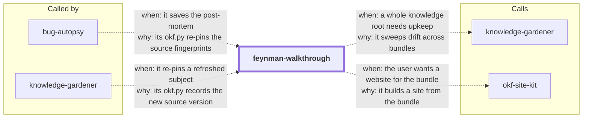

# feynman-walkthrough

An understanding-first walkthrough guide. Given anything a person (or an agent) wants to
genuinely understand — a subject, a codebase, a whitepaper, a complex system — it runs a
guided walkthrough: the big picture first, then one segment at a time, explained with
Feynman-grade simplicity (plain language, analogy, concrete example before abstraction)
and structured by the instructional-design research on how explanations land (advance
organizers, segmenting, worked examples, dual coding).

Understanding checks come **after** the walkthrough — a few questions that tell the
coach where to re-explain, never a pretest or a quiz gate. Long-term-retention tooling
(spaced retrieval, review schedules) exists but is strictly opt-in.

> Formerly `desirable-difficulty`. The rename tracks the redesign: retention-first
> coaching became understanding-first walkthroughs, with the desirable-difficulty
> techniques moved into the opt-in recall track.

<!-- skill-graph:start -->
## Where it fits

<!-- Generated by scripts/gates/skill_graph.py from docs/skill-graph/graph.json. Do not edit this block by hand: edit the JSON, then run `make skill-graph`. -->

**Start here if** you want to understand a codebase, a paper or a system. `bug-autopsy` and `knowledge-gardener` also use it when it is installed.



An arrow from A to B means A sends work or data to B. `==>` contract envelope, `-->` required, `--o` handoff (you start the next skill), `-.->` optional (only when installed). The map of all skills is in the [root README](../README.md#how-the-skills-fit-together).
<!-- skill-graph:end -->

## Install

```bash
npx skills add dhanesh/agent-skills --skill feynman-walkthrough
```

## What it does

1. Scopes lightly (what's the material, what's the goal, what do they already know) so
   the walkthrough starts at the right altitude.
2. Maps: the one-paragraph Feynman version of the whole thing, then the 3–7 segment
   plan.
3. Walks through segment by segment — plain language first, one concrete example or
   traced path each, questions invited at every boundary.
4. Checks understanding after the walkthrough and re-explains shaky segments from a
   different angle (new analogy, smaller steps) until it lands.
5. Delivers a standalone **reference explainer** — complete, readable without the
   session, sharable with someone who wasn't there.
6. Persists it as an **Open Knowledge Format (OKF) bundle** (`assets/okf.py`,
   stdlib-only) with each source's fingerprint pinned — git HEAD for a repo, sha256 for
   a file — so a later session can `status`-check whether the source drifted and
   refresh the explainer diff-aware instead of re-explaining from scratch.
7. Offers — once — an opt-in recall track (`assets/spaced_schedule.py` expanding-interval
   review schedule) for learners who also want the material to stick long-term.

## Output

Enriched understanding, evidenced by: the walkthrough itself, the reference explainer
(rendered artifact + OKF bundle on disk), and a plain statement of which segments are
solid and which were re-coached. Optionally, on opt-in: a dated review schedule.

## Layout

- `SKILL.md` — the walkthrough prompt (quality bar, method anchors, workflow).
- `references/explanation-playbook.md` — the Feynman moves, research-backed structuring
  techniques, altitude calibration, check design, and segment maps per material type
  (codebase, whitepaper, algorithm, concept, process, quantitative).
- `references/codebase-learning.md` — the domain playbook for touring a codebase or
  technical system (map → narrated trace → design whys → check → explainer).
- `references/okf.md` — the OKF v0.1 persistence layer: spec adherence, bundle layout,
  examples, and the review/refresh session flows.
- `references/agent-surface.md` — mapping the workflow onto host-agent capabilities
  (question UIs, artifacts, schedulers, files) with graceful fallbacks.
- `references/question-frameworks.md` — Bloom's ladder, QFT, QAR, 5 Whys, reframed for
  check design and explainer preparation.
- `references/evidence.md` — the research base for both halves: explanation-side
  findings (Ausubel, Mayer, Sweller, Chi) and the recall-track evidence (Dunlosky
  et al. 2013; 2021 meta-analysis: 242 studies, ~169k participants), with honest
  caveats.
- `assets/okf.py` (+ `test_okf.py`) — OKF bundle tool: init/status/pin/list with
  source-fingerprint drift detection, stdlib-only.
- `assets/spaced_schedule.py` (+ `test_spaced_schedule.py`) — expanding-interval
  schedule generator for the opt-in recall track, stdlib-only.

See `SKILL.md` for the full procedure.

## Changes

- **1.2.3.** SKILL.md says how to find Python when `python3` is missing, too old or the macOS install stub.
