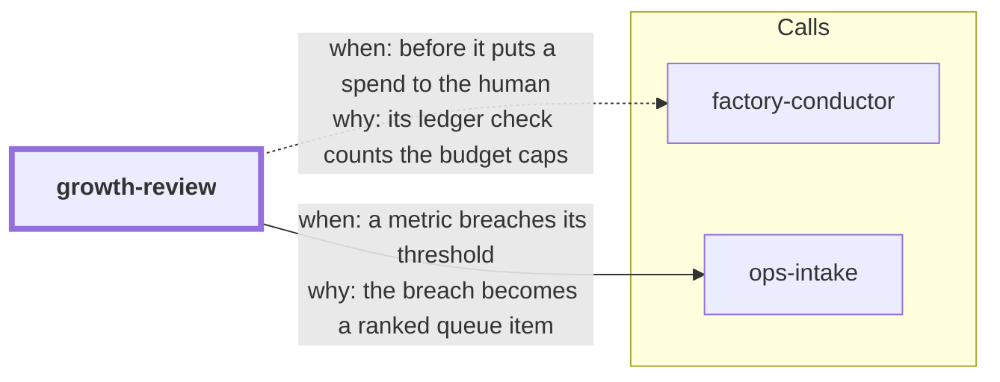

# growth-review

growth-review checks your product metrics against targets that you set before the data came
in. You write a metrics plan: for each metric, a warning line and a breach line. A small local
tool imports the data you export and reports OK, WARN, BREACH or NO_DATA for each metric. A
breach goes into the ops-intake queue, the same queue as a failed release. So a falling
metric reaches planning the same way as a bug.

```bash
npx skills add dhanesh/agent-skills --skill growth-review
```

<!-- skill-graph:start -->
## Where it fits

<!-- Generated by scripts/gates/skill_graph.py from docs/skill-graph/graph.json. Do not edit this block by hand: edit the JSON, then run `make skill-graph`. -->

**Start here if** you want your product metrics checked against thresholds.



An arrow from A to B means A sends work or data to B. `==>` contract envelope, `-->` required, `--o` handoff (you start the next skill), `-.->` optional (only when installed). The map of all skills is in the [root README](../README.md#how-the-skills-fit-together).
<!-- skill-graph:end -->

## How it works

1. **Plan.** You and the agent write `growth/metrics.md`. Each row has a metric, a direction
   (`up` means higher is better), a period (day, ISO week or month), a `warn` value and a
   `breach` value. `min_n` and `severity` are optional.
2. **Register.** You confirm the plan. The tool stores a frozen copy of the thresholds with
   your name. The agent cannot register: the tool refuses a name that starts with `agent:`.
3. **Export.** You export the numbers from your analytics or payment tool. The agent can run
   a read-only export with your login, and it can turn the export into the tool's JSON-lines
   format. The tool stores the data in `.skill-contract/growth/`, which git ignores.
4. **Review.** The tool looks at the last complete period of each metric, by the UTC clock,
   and prints its status. If the newest period has no data, the status is NO_DATA. The tool
   does not fall back to older data.
5. **Queue.** The agent pipes `growth.py signals` into ops-intake's `import`, with
   `set -o pipefail`, and checks that the counts agree. Each metric in
   BREACH becomes one ops-intake item. Each new breached period raises the item's count by
   one.

## What it protects

- **Moved goalposts.** If someone edits a threshold after registration, the plan is STALE.
  The review still uses the frozen thresholds. It marks every line `+stale` and exits 3. A
  breach under the frozen thresholds is still a breach and still goes to the queue. Only you
  can register the new thresholds, with a reason.
- **Vanishing breaches.** If a corrected number moves a period out of BREACH, the review
  prints a `CORRECTED:` line, so you can see the change. A corrected `n` shows too. If the
  correction is for the newest period, or that period has a value with too small an `n`, the
  review exits 3.
- **Reset by hand.** If someone deletes or empties the registration file, `register` needs a
  reason again, because the log still remembers the old registration. The review compares the
  file with the log and exits 3 when they disagree.
- **Unfinished periods.** The tool takes only periods that have ended by today (UTC). A day
  label for tomorrow is refused.
- **Business data.** The tool sends nothing anywhere. The agent sends no metric value to Jev or
  to any other model. It changes nothing in your analytics, payment or store accounts. It
  does not publish, post, email, change a price or spend money.

## Limits

- Names are claims. The tool cannot check who typed `--by`.
- Read-only use of analytics tools is not enforced by the tool. Your permission prompts are
  the control.
- The committed plan can show your revenue targets. The data itself is git-ignored.
- A month or week that is still running is refused as a future period. Export finished
  periods only.
- No launch or pricing checklist, no money ledger (factory-conductor 1.5.0 has one), no
  forecasts and no statistics. Launch and pricing stay manual.
- When a metric recovers, nothing closes the ops-intake item. You resolve or dismiss it there.
  A dismissed item comes back at the next breached period.

## Changes

- **0.1.3.** The `compatibility` line now names `python3`, `python` or `$SKILL_PYTHON`, as the Python interpreter rule allows.
- **0.1.2.** SKILL.md says how to find Python when `python3` is missing, too old or the macOS install stub.
- **0.1.1.** One agent-name check for growth-review, idea-validation and factory-conductor's
  ledger. `register` now refuses a name that starts with the word `agent` in any form: a bare
  `agent`, any separator after it (`agent x`, `agent.x`, `agent;x`, a lookalike colon), its
  letters apart (`a gent:x`), and small-capital or IPA lookalike letters. Before, these
  passed. A human name that starts with that word, such as `Agent Smith`, is refused too:
  the check fails closed. SKILL.md also tells the agent to run factory-conductor's ledger
  check before it puts any spend to the human, and says that a pass is not approval.

## Tests

The unit tests and the eval run the tool with a fixed date. `--today` works only when the
environment sets `GROWTH_TEST_CLOCK=1`, which only the tests and the eval do. In a real run
the tool refuses `--today`. The agent-facing text does not name this variable.

## Files

- `SKILL.md`: the agent's instructions.
- `references/metrics-format.md`: the plan grammar, the data format, the review rules, the
  signal line and what ops-intake does with it.
- `references/parameters.md`: the commands, flags and exit codes.
- `assets/growth.py`: the tool (Python 3.10+, standard library only).
- `assets/test_growth_*.py`: the unit tests. `test_growth_signals.py` feeds real lines to
  ops-intake's adapter and CLI from the sibling directory.
- `eval/run_eval.py`: the outcome eval.
