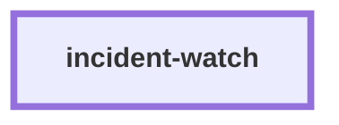

# incident-watch

**Status: in development: no command ships yet.**

This skill will find and triage live incidents for the software factory. On a schedule,
`incident probe` will run only the release recipe's read-only `health`, `version_probe`
and `prod_smoke` commands. After 2 or more consecutive failed probes, it will open one
incident record with evidence. It will also write an `incident` signal into ops-intake.
The record will show the recipe's rollback command word for word. The skill will never
run a rollback or a deploy. The owner fixes the problem through release-conductor.
Then `incident close --by <name>` will hand the record to bug-autopsy.

Today the skill has no script, no command and no behaviour. It only tells the agent to
say so and to name the skills that do each step by hand.

The design is in
[`docs/factory/2026-11-04-autonomous-factory-spec.md`](../docs/factory/2026-11-04-autonomous-factory-spec.md)
(requirements R22 to R26 and decision D1).

<!-- skill-graph:start -->
## Where it fits

<!-- Generated by scripts/gates/skill_graph.py from docs/skill-graph/graph.json. Do not edit this block by hand: edit the JSON, then run `make skill-graph`. -->

**Works alone.** No other skill in this repo calls it, and it calls none. Start here if you want production watched for incidents, which is in development with no command yet.



The map of all skills is in the [root README](../README.md#how-the-skills-fit-together).
<!-- skill-graph:end -->

## Install

```bash
npx skills add dhanesh/agent-skills --skill incident-watch
```

## Usage

Ask for incident-watch, or ask to "watch production for incidents". The agent tells you
that no command ships yet. Then it names the installed skill that does each step by
hand. The step list is in [`references/overview.md`](references/overview.md).

## Layout

- `SKILL.md`: the agent-facing prompt.
- `references/overview.md`: the planned steps and the skills that do them by hand today.
- `assets/test_incident_watch_smoke.py`: a stdlib test suite for the skeleton.
- `eval/run_eval.py`: an outcome eval that checks the skeleton claims nothing it does
  not have (see the repo's `docs/eval-standard.md`).
