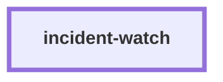

# incident-watch

**Status: partly built.** `incident probe` ships. The incident record, the `incident`
signal, the refusal of other commands and `incident close` are not built yet.

This skill finds and triages live incidents for the software factory. The factory
detects, and the owner fixes (decision D1).

What ships now:

- `incident probe` loads the release recipe with release-conductor's own loader. It runs
  only the recipe's read-only `health`, `version_probe` and `prod_smoke` commands (R22).
  Each command runs as an argv list, with no shell and with a timeout. The tool records
  each result (the time, the command, the exit code and the last 2000 characters of
  output) in `.skill-contract/incidents/`, which is git-ignored. It prints one `PROBE:`
  line per command and one `PROBE_RESULT:` line. It also counts the consecutive failed
  probes.

What is pending:

- Refuse any command that is not in the three lists, with exit 2 (R23).
- After 2 or more consecutive failed probes, open one incident record with evidence and
  write one `incident` signal into ops-intake (R24).
- Show the recipe's rollback command word for word in the record (R25).
- `incident close --by <name>` hands the record to bug-autopsy (R26).

The skill never runs a rollback or a deploy. The owner fixes the problem through
release-conductor.

The design is in
[`docs/factory/2026-11-04-autonomous-factory-spec.md`](../docs/factory/2026-11-04-autonomous-factory-spec.md)
(requirements R22 to R26 and decision D1).

<!-- skill-graph:start -->
## Where it fits

<!-- Generated by scripts/gates/skill_graph.py from docs/skill-graph/graph.json. Do not edit this block by hand: edit the JSON, then run `make skill-graph`. -->

**Works alone.** No other skill in this repo calls it, and it calls none. Start here if you want production probed for incidents with the read-only checks of the release recipe, which is partly built.



The map of all skills is in the [root README](../README.md#how-the-skills-fit-together).
<!-- skill-graph:end -->

## Install

```bash
npx skills add dhanesh/agent-skills --skill incident-watch
```

Install release-conductor too. incident-watch reads the recipe with its loader.

## Usage

```bash
python3 incident-watch/assets/incident.py --root <repo> probe [--version V] [--commit C] [--timeout S]
```

Exit 0 means every command passed. Exit 3 means a command failed or timed out. Exit 2
means the tool refused and ran nothing.

## Layout

- `SKILL.md`: the agent-facing prompt.
- `assets/incident.py`: the probe tool.
- `assets/incident_testkit.py`: a fixture repo whose recipe commands are local stubs.
- `assets/test_incident.py`: the unit suite.
- `assets/test_incident_watch_smoke.py`: a stdlib test suite for the skill's shape.
- `references/overview.md`: the steps, what ships and what is pending.
- `eval/run_eval.py`: an outcome eval that runs the probe on the fixture (see the repo's
  `docs/eval-standard.md`).
