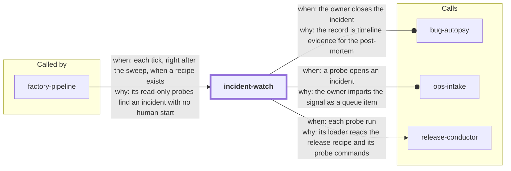

# incident-watch

**Status: built.** `incident probe` ships. It opens an incident record and writes an
`incident` signal. The record shows the rollback command. `incident close` closes the
record and hands it to bug-autopsy.

This skill finds and triages live incidents for the software factory. The factory
detects, and the owner fixes (decision D1).

What ships now:

- `incident probe` loads the release recipe with release-conductor's own loader. It runs
  only the recipe's read-only `health`, `version_probe` and `prod_smoke` commands (R22).
  Each command runs as an argv list, with no shell and with a timeout. The tool records
  each result (the time, the command, the exit code and the last 2000 characters of
  output) in `.skill-contract/incidents/`, which is git-ignored. It prints one `PROBE:`
  line per command and one `PROBE_RESULT:` line. It also counts the consecutive failed
  probes.
- The probe refuses any command that is not in the three lists, with exit 2, and then
  runs nothing (R23). `--only health|version_probe|prod_smoke` runs one list. Any other
  name, an extra argument after `probe`, or a probe entry whose program word holds a
  `{token}` is refused.
- After 2 or more consecutive failed probes, the probe opens one incident record (R24).
  The record is `.skill-contract/incidents/records/<id>.json`. It holds the failed probes
  with their output, the last release record from release-conductor and the recent CI
  runs on the default branch. The probe also writes one line of kind `incident` to
  `.skill-contract/incidents/signals.jsonl`. ops-intake imports that file with
  `intake import --format intake-signals-jsonl --source incident-watch`. A third failure
  opens no second record. It adds the probe to the open record.
- The record shows the recipe's rollback command word for word (R25). Its `rollback`
  field holds the argv list as the recipe holds it, with `{version}` and `{commit}`
  unfilled, and a display form with control characters escaped. It also holds the
  release-conductor command that asks the owner: `release rollback` shows the rollback
  and waits, and `release rollback --approved-by "<their name>"` runs it after the
  owner's yes. The probe that opens the record prints a `ROLLBACK:` line and a
  `NEXT: ask the owner to roll back: ...` line. `release rollback` acts only on a
  release in `prod_failed` or `outcome_unknown`. If no release is in one of those states,
  the `NEXT:` line says that `release rollback` cannot act and that the owner rolls back
  by hand. Every printed line escapes control characters, so recipe text cannot add a
  line. If the recipe has no valid `rollback`
  field, the record says so, and the probe goes on.
- The probe never calls `gh` or the network. When the CI runs are not on disk, the record
  says so. The probe then prints the `NEXT: gh run list ...` line that you run to get
  them.

- `incident close --by <name>` closes the open record (R26). Closing is a human step.
  The tool refuses a missing `--by` and any name that starts with the word "agent", with
  the same check that growth-review and ops-intake use. The record gets `closed_by`,
  `closed_at` and `close_reason`. The failure count goes back to 0, so a new failure
  streak opens a new record. The tool prints
  `NEXT: run bug-autopsy with <record path>`. If more than one record is open, `--id`
  names the record to close. The command takes the same lock as `probe`.

The skill never runs a rollback or a deploy. The owner fixes the problem through
release-conductor.

The design is in
[`docs/factory/2026-11-04-autonomous-factory-spec.md`](../docs/factory/2026-11-04-autonomous-factory-spec.md)
(requirements R22 to R26 and decision D1).

<!-- skill-graph:start -->
## Where it fits

<!-- Generated by scripts/gates/skill_graph.py from docs/skill-graph/graph.json. Do not edit this block by hand: edit the JSON, then run `make skill-graph`. -->

**Start here if** you want production probed for incidents with the read-only checks of the release recipe, and each closed incident record handed to bug-autopsy. Other skills also send work here: `factory-pipeline`.



An arrow from A to B means A sends work or data to B. `==>` contract envelope, `-->` required, `--o` handoff (you start the next skill), `-.->` optional (only when installed). The map of all skills is in the [root README](../README.md#how-the-skills-fit-together).
<!-- skill-graph:end -->

## Install

```bash
npx skills add dhanesh/agent-skills --skill incident-watch
```

Install release-conductor too. incident-watch reads the recipe with its loader.

## Usage

```bash
python3 incident-watch/assets/incident.py --root <repo> probe [--version V] [--commit C] [--timeout S]
python3 incident-watch/assets/incident.py --root <repo> close --by "<owner>" [--reason R] [--id ID]
```

After the second consecutive failure, the output also has `INCIDENT: opened <id> <path>`,
`SIGNAL: ...`, `ROLLBACK: ...` and `NEXT:` lines. `references/overview.md` lists the record fields.

Exit 0 means every command passed, or the record closed. Exit 3 means a command failed or
timed out, or another command holds the lock. Exit 2 means the tool refused and changed
nothing.

## Layout

- `SKILL.md`: the agent-facing prompt.
- `assets/incident.py`: the probe and close tool.
- `assets/incident_testkit.py`: a fixture repo whose recipe commands are local stubs.
- `assets/test_incident.py`: the unit suite.
- `assets/test_incident_watch_smoke.py`: a stdlib test suite for the skill's shape.
- `references/overview.md`: the steps, the output lines and the record fields.
- `eval/run_eval.py`: an outcome eval that runs the probe on the fixture (see the repo's
  `docs/eval-standard.md`).
