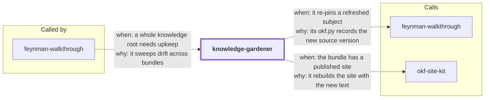

# knowledge-gardener

Keep Open Knowledge Format (OKF v0.1) bundles alive. Bundles pin a fingerprint of every
source their explainers were built from — git HEAD for repos, sha256 for files and
directories — and reality keeps moving after the pin. This skill sweeps one or more
knowledge roots, reports which subjects have drifted from their pinned sources, drives a
diff-aware refresh (rewrite only the segments the diff touched, re-pin, log), and
regenerates any published site.

It completes the knowledge trilogy in this repo:

| Skill | Role |
|---|---|
| `feynman-walkthrough` | **creates** bundles — walkthroughs persisted as pinned explainers |
| `okf-site-kit` | **publishes** them — a browsable static site over any bundle |
| `knowledge-gardener` | **maintains** them — drift detection, refresh, re-pin, republish |

<!-- skill-graph:start -->
## Where it fits

<!-- Generated by scripts/gates/skill_graph.py from docs/skill-graph/graph.json. Do not edit this block by hand: edit the JSON, then run `make skill-graph`. -->

**Usually called by** `feynman-walkthrough`. You can also start it yourself when you want to find and refresh stale knowledge bundles.



An arrow from A to B means A sends work or data to B. `==>` contract envelope, `-->` required, `--o` handoff (you start the next skill), `-.->` optional (only when installed). The map of all skills is in the [root README](../README.md#how-the-skills-fit-together).
<!-- skill-graph:end -->

## What ships

- `assets/garden.py` — stdlib-only, self-contained sweeper. `sweep <root>...` prints a
  per-subject FRESH/STALE/UNKNOWN/ERROR report (for stale git sources: pinned vs
  current SHA, `git diff --stat` summary, changed file names) and exits non-zero on any
  STALE/ERROR, so it works as a gate. `json <root>...` emits the same facts as JSON.
  Malformed frontmatter becomes an ERROR entry, never a crash. Its status semantics
  agree exactly with `feynman-walkthrough`'s okf.py, without importing it.
- `references/refresh-playbook.md` — the diff-aware refresh procedure the agent follows
  for STALE, UNKNOWN, and ERROR subjects.
- `assets/test_garden.py` — 31-test stdlib unit suite; `eval/run_eval.py` — the
  deterministic outcome eval (real git repo fixture, drift, corruption, all offline).

## Install

```bash
npx skills add dhanesh/agent-skills --skill knowledge-gardener
```

## Usage

Ask the agent to check or maintain your knowledge — "is my knowledge base still
current?", "sweep docs/knowledge for stale subjects", "the repo changed, update the
explainer" — or run the sweeper directly:

```bash
python3 assets/garden.py sweep docs/knowledge ~/knowledge   # human report, gate exit code
python3 assets/garden.py json docs/knowledge                # machine-readable
```

Typical report:

```
BUNDLE: /work/app/docs/knowledge (okf_version 0.1) — 2 subject(s)
  SUBJECT: ingest-pipeline — STALE
    SOURCE: git /work/app — STALE
      pinned 4f2a9c8b11de -> current 9e01d3aa72cf
      diff: 3 files changed, 41 insertions(+), 7 deletions(-)
      changed: src/ingest/retry.py src/ingest/backoff.py docs/ops.md
  SUBJECT: design-doc — UNKNOWN
    SOURCE: external https://example.com/design-doc — UNKNOWN
GARDEN_RESULT: STALE (fresh 0, stale 1, unknown 1, error 0; 2 subject(s), 1 bundle(s))
```

The agent then refreshes the stale subject diff-aware, re-pins its fingerprints,
appends the update to the bundle's `log.md`, and — if the bundle has a published site —
regenerates it via `okf-site-kit`.

## Tests

```bash
cd knowledge-gardener/assets && python3 test_garden.py   # unit suite
python3 knowledge-gardener/eval/run_eval.py              # outcome eval
make gate-skill SKILL=knowledge-gardener                 # everything CI checks
```

## Changes

- **1.0.4.** The `compatibility` line now names `python3`, `python`, `py -3` or `$SKILL_PYTHON`, as the Python interpreter rule allows.
- **1.0.3.** SKILL.md says how to find Python when `python3` is missing, too old or the macOS install stub.
