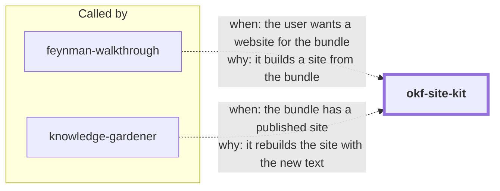

# okf-site-kit

Turn any **Open Knowledge Format (OKF v0.1)** bundle into a beautiful, browsable
static website. OKF — Google's open spec for agent-readable knowledge
([SPEC.md](https://github.com/GoogleCloudPlatform/knowledge-catalog/blob/main/okf/SPEC.md))
— is deliberately just markdown + YAML frontmatter with no required tooling. This skill
supplies the missing "browse it" half: a stdlib Python generator that reads a bundle
and emits a complete Astro + Starlight project.

```bash
python3 assets/okf_site.py inspect  ./knowledge
python3 assets/okf_site.py generate ./knowledge --out ./site --title "Team Knowledge"
cd site && npm install && npm run build   # static site in dist/
```

<!-- skill-graph:start -->
## Where it fits

<!-- Generated by scripts/gates/skill_graph.py from docs/skill-graph/graph.json. Do not edit this block by hand: edit the JSON, then run `make skill-graph`. -->

**Usually called by** `feynman-walkthrough` and `knowledge-gardener`. You can also start it yourself when you want a website from a knowledge bundle.



An arrow from A to B means A sends work or data to B. `==>` contract envelope, `-->` required, `--o` handoff (you start the next skill), `-.->` optional (only when installed). The map of all skills is in the [root README](../README.md#how-the-skills-fit-together).
<!-- skill-graph:end -->

## Install

```bash
npx skills add dhanesh/agent-skills --skill okf-site-kit
```

## What you get

- **Hero landing page** with a link card per top-level section (descriptions harvested
  from the root index's own bullet annotations) and a tagline from the bundle itself.
- **One page per concept** with an OKF metadata panel: color-coded `type` badge, tag
  chips, resource link, updated timestamp, and any producer-defined frontmatter keys
  (e.g. `feynman-walkthrough`'s source pins) rendered generically.
- **Internal links rewritten** (`../references/metrics/event_count.md` →
  `/references/metrics/event-count/`), bundle assets copied and served, headings
  normalized, `log.md` turned into a Changelog page.
- **From Starlight, for free**: full-text search (Pagefind), dark/light theme, mobile
  layout, per-page table of contents.
- **Deploy-ready**: `--base`/`--site`/`--deploy-workflow` emit a GitHub Pages setup.

## Coverage

Built against a survey of every OKF bundle dialect published so far — Google's three
sample bundles (`ga4`, `stackoverflow`, `crypto_bitcoin`: block-list tags, folded
descriptions, `.md` links, `viz.html` assets, no `okf_version`), spec-canonical
bundles (`okf_version`, `log.md`, absolute links), and producer-extended bundles
(arbitrary frontmatter, block lists of dicts). Spec violations degrade gracefully with
`WARN:` reporting, per the spec's consumer rules. The survey and per-variation
handling rules live in `references/bundle-variations.md`.

## Layout

- `SKILL.md` — the agent prompt (ground rules, workflow, verify checklist).
- `assets/okf_site.py` — the generator: tolerant YAML frontmatter parser, bundle
  scanner, route planner, link/heading transforms, site emission, conformance report.
- `assets/test_okf_site.py` — 32-test stdlib suite with fixtures per bundle family.
- `references/okf-spec.md` — consumer-side OKF summary + spec-update rule.
- `references/bundle-variations.md` — the in-the-wild survey (coverage contract).
- `references/parameters.md` — CLI commands and flags.

Verified end-to-end: generated from a ga4-shaped fixture bundle, `npm run build`
green (9 pages + search index), homepage and concept pages visually checked.

## Changes

- **1.1.5.** The `compatibility` line now names `python3`, `python` or `$SKILL_PYTHON`, as the Python interpreter rule allows.
- **1.1.4.** SKILL.md says how to find Python when `python3` is missing, too old or the macOS install stub.
