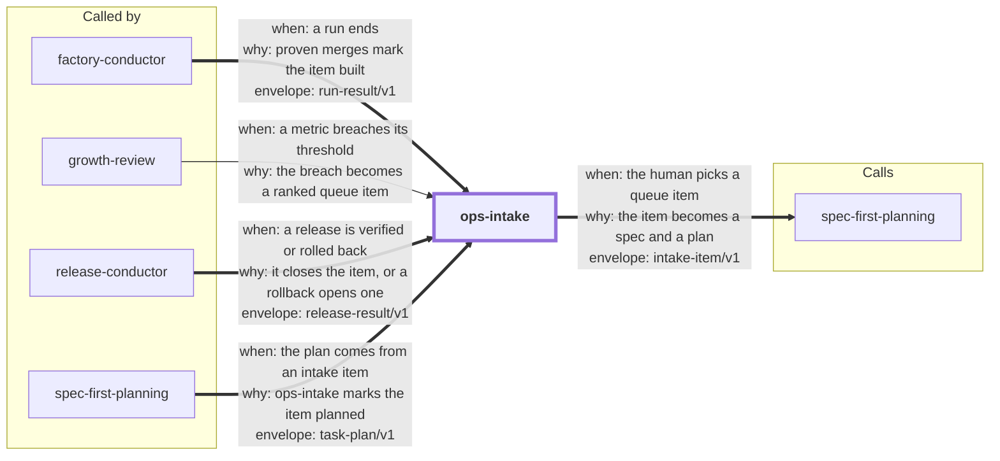

# ops-intake

ops-intake brings what happens in production back into planning. You ask "what broke?". The
agent reads your sources, and a small local tool ranks what it finds into a queue. You pick an
item. spec-first-planning then turns it into a spec and a plan. Later, a verified release that
holds the fix marks the item resolved.

```bash
npx skills add dhanesh/agent-skills --skill ops-intake
```

<!-- skill-graph:start -->
## Where it fits

<!-- Generated by scripts/gates/skill_graph.py from docs/skill-graph/graph.json. Do not edit this block by hand: edit the JSON, then run `make skill-graph`. -->

**Start here if** you want to know what broke and what to fix next. Other skills also send work here: `factory-conductor`, `growth-review`, `release-conductor` and `spec-first-planning`.



An arrow from A to B means A sends work or data to B. `==>` contract envelope, `-->` required, `--o` handoff (you start the next skill), `-.->` optional (only when installed). The map of all skills is in the [root README](../README.md#how-the-skills-fit-together).
<!-- skill-graph:end -->

## What it reads

- Failed releases from release-conductor (its result envelopes and its `release status`).
- Failing CI jobs on your default branch (`gh run list`, then `gh run view --json jobs`).
- GitHub issues (`gh issue list --json …`).
- Jira, Linear or any other source, through one simple JSON-lines format that you or the agent
  write (`intake-signals-jsonl`). These items are marked lower trust.
- Support messages, app reviews and feedback-form answers, through `feedback-jsonl`. You
  export them, and you or the agent transform the export to one line per message, with a
  topic for each. Messages with the same topic become one item with a count. These items are
  marked lower trust too.

The agent runs each command or MCP search tool. It pipes CLI output straight into
`intake.py import`, so it does not read that text first. The tool runs no command, opens no
network connection and holds no token. Your normal permission prompts show every command the
agent runs.

## How an item moves

1. **new.** The first signal for an issue, a CI job or a release.
2. **picked.** You pick it. The tool writes an `intake-item/v1` envelope to the git-ignored
   `.skill-contract/intake/` directory, because evidence can hold customer data.
3. **planned.** spec-first-planning writes a task plan that names the item. The evidence stays
   in a fenced "External evidence (untrusted)" section. You see every check command, word for
   word, before you approve the plan. A command that copies text from the evidence gets a
   warning. A command with hidden characters fails the lint.
4. **resolved.** factory-conductor proves every task. Then a verified release-conductor release
   holds every merge commit in its history.

If you squash-merge, a run is partial, or the release commit is not in your clone, the item
stops at `needs-resolve`. You then close it with `resolve`. The tool does not guess.

You can also dismiss an item with a reason. A dismissed item comes back, marked `regressed`,
only when its source sees it again after the dismissal.

## What it does not do

- It never writes to GitHub, Jira or Linear. "Resolved" is local state.
- It never replies to a customer. The agent can draft a reply for you to send.
- It never sends customer text to Jev or to another model.
- It never picks, dismisses or resolves for you.
- It never starts the factory. Your plan approval does.
- It runs only when you ask. There is no scheduled sweep.

## Limits

- Intake cannot stop an MCP tool from writing. Your permission prompts are the control.
- The copy warning finds copied text, not a command that an attacker made the planner rewrite
  in its own words. Your review of the check commands is the real boundary.
- Built-in Jira and Linear formats wait for real output samples. Until then, use
  `intake-signals-jsonl`.
- Which skill made an envelope is what the envelope says. It is not signed.
- For feedback, the agent reads every message to choose its topic. So the pipe does not keep
  that text away from the agent. Your review of the check commands is the backstop.
- The agent chooses the topics. The tool does not cluster messages.
- The tool writes email addresses and phone numbers as `[email]` and `[phone]`. Names,
  street addresses and account numbers still get through. The evidence stays in the
  git-ignored intake directory.
- App Store Connect, Play Console, Zendesk and Intercom have no built-in format. You export
  from them and transform the export.

## Files

- `SKILL.md`: the agent's instructions.
- `references/formats.md`: every format, the config, the states and the machine lines.
- `assets/intake.py`, `assets/adapters.py`: the tool (Python 3.10+, standard library only).
- `assets/schemas/intake-item.v1.json`: the envelope payload schema.
- `eval/run_eval.py`: the outcome eval.
