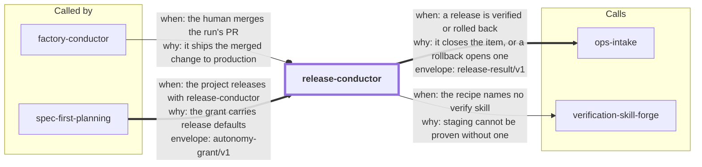

# release-conductor

Carry a merged change to **verified production**. The agent drives `assets/release.py`, a
stdlib state tool that reads your project's release recipe (`.release/recipe.json`) and runs
the release in steps: prep the version bump and changelog on a release branch and open the
release PR; after you merge it, build the merged commit, have an independent verifier prove it
with your verify skill, deploy it to staging and check it there; deploy to production only
after your explicit yes for this release; then prove production runs that commit. A failed
production check asks for your yes before it rolls back. Each release ends with a
`release-result/v1` envelope.

This is the release step of the collection's [software factory](../README.md#software-factory):
`spec-first-planning` plans, `factory-conductor` builds to a PR, `verification-skill-forge`
makes the verify skill, and this skill releases what you merged.

<!-- skill-graph:start -->
## Where it fits

<!-- Generated by scripts/gates/skill_graph.py from docs/skill-graph/graph.json. Do not edit this block by hand: edit the JSON, then run `make skill-graph`. -->

**Usually called by** `factory-conductor` and `spec-first-planning`. You can also start it yourself when a merged change has to go to production.



An arrow from A to B means A sends work or data to B. `==>` contract envelope, `-->` required, `--o` handoff (you start the next skill), `-.->` optional (only when installed). The map of all skills is in the [root README](../README.md#how-the-skills-fit-together).
<!-- skill-graph:end -->
**0.1.2.** SKILL.md says how to find Python when `python3` is missing, too old or the macOS install stub.

**0.1.1.** The contract checker honours `SKILL_PYTHON` (after `SKILL_CONTRACT_PYTHON`) and skips the macOS `python3` install stub without running it.

## Install

```bash
npx skills add dhanesh/agent-skills --skill release-conductor
```

Install it next to `verification-skill-forge`, whose verify skill staging needs. It needs
macOS or Linux and Python 3.10+.

## Usage

1. **Once per project:** ask the agent to set up releases. It reads the repo, asks you for the
   recipe's commands (build, staging and production deploys, rollback, health, a version
   probe, staging checks, read-only production smoke checks), writes the recipe with
   `release init`, and you merge it through a normal PR.
2. **Each release:** say "release this". The agent shows you what the release grant covers and
   asks for your yes, then runs `prep`, which opens the release PR. Merge it.
3. The agent runs `stage`, dispatches a verifier, and stages the release. Nothing triggers
   this automatically after your merge: a session runs it.
4. The agent shows you the deploy summary (version, commit, evidence, recipe sha, the exact
   deploy and rollback commands) and asks for your yes. On yes it deploys and runs
   `verify-prod`. If production fails its checks, it asks before it rolls back.

## What it enforces, and what it does not

- **Production always asks.** No grant covers a production deploy or a rollback; the tool
  waits at `awaiting_deploy` until it is run with your yes, which it records as CLAIMED
  (an agent with a shell could forge it, so it is never called verified).
- **Staging is proven.** A verifier other than the agent that prepared the release records
  SHA-bound evidence for every feature your verify skill maps, at exactly the release commit,
  before anything reaches staging.
- **The recipe is pinned.** The release grant pins the recipe's digest and the version;
  a recipe changed in the release, or a merged commit with another version, stops the release.
- **No headless path to production.** The tool refuses while any live grant's headless
  allowlist could run the production deploy or rollback, including expired grants you have
  not revoked. It cannot see allowlists outside the grant (such as `.claude/settings.json`).
- **A tag push that deploys is a deploy.** When your CI may run on a tag, the tag is held for
  your production yes. Unknown CI formats count as tag-triggered: one extra ask, never a silent
  deploy.
- **Unknown stays unknown.** A deploy or rollback that times out or dies is never re-run;
  verify-prod checks a deploy once and the rest is your call.
- **Limits.** With `"artifact": "rebuild"`, staging verified the same source, not the same
  bytes. Production checks are only as good as your `prod_smoke` list. Recipe commands run
  with your credentials. A permission prompt is no gate if you bypass prompts.

Revoke every live grant at once with
`python3 <skill>/assets/contract_check.py revoke-grant --root <repo>`: every release step then
stops at its next gate.

## Layout

- `SKILL.md`: the agent-facing protocol.
- `references/release-protocol.md`: every command, line, exit code and state, the recipe
  schema, the grant, the CI-tag rule and a worked example.
- `assets/release.py`: the state tool; `assets/contract_check.py`: the vendored skill-contract
  checker; `assets/schemas/release-result.v1.json`: the result payload schema.
- `assets/test_release_*.py`: stdlib suites, including an end-to-end run against a local
  server (`test_release_e2e.py`).
- `eval/run_eval.py`: the outcome eval (see the repo's `docs/eval-standard.md`).
