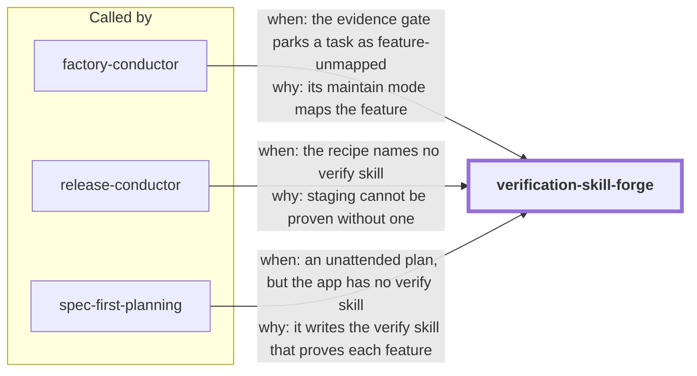

# verification-skill-forge

Tests passing is not verification. A change is verified when an agent has driven the
real running app the way a user would and captured proof of what happened, on a named
commit. This skill generates the project-local `verify-<app>` skill that does that, and
keeps it honest as the app changes.

The generated skill has five sections (Launch, Doctor, Drive, Evidence, Cleanup) filled
with real commands from the target repo, a feature map (one file per user-facing
feature: how to reach it, how to drive it, what proves it worked), and a vendored
evidence recorder that writes `.verify/<instance>/<feature>/<sha>/evidence.json`, with
the commit read from git and every artifact pinned by sha256.

What the tooling enforces:

- **No placeholder skills.** `forge.py lint` fails `FILL:`/TODO markers, names from
  examples, command-less sections, a Launch that takes no instance, a Doctor that writes,
  a Drive that clicks coordinates, a reworded proof standard, a Cleanup that deletes
  evidence, and a feature that claims `proven` for source that no longer exists.
- **Parallel-safe instances.** Every instance claims its own port through an O_EXCL lock;
  a second owner asking for a held port is refused.
- **The Manifold join.** With `.manifold/` present, `forge.py coverage` names every
  anchored constraint with no observable proof: the real verification backlog. A
  malformed manifold degrades to source-derived discovery.
- **Maintain can't hide bugs.** `forge.py check-maintain` fails a feature whose
  documented behaviour changed while none of its source did; the mismatch is recorded as
  a product-bug finding instead.

factory-conductor's evidence gate reads the records this produces.

<!-- skill-graph:start -->
## Where it fits

<!-- Generated by scripts/gates/skill_graph.py from docs/skill-graph/graph.json. Do not edit this block by hand: edit the JSON, then run `make skill-graph`. -->

**Usually called by** `factory-conductor`, `release-conductor` and `spec-first-planning`. You can also start it yourself when an app needs a verify skill that proves features work at runtime.



An arrow from A to B means A sends work or data to B. `==>` contract envelope, `-->` required, `--o` handoff (you start the next skill), `-.->` optional (only when installed). The map of all skills is in the [root README](../README.md#how-the-skills-fit-together).
<!-- skill-graph:end -->

## Install

```bash
npx skills add dhanesh/agent-skills --skill verification-skill-forge
```

## Usage

"Make a verify skill for this app", "how would an agent prove this feature works",
"audit the verify skill". The skill detects forge vs maintain mode itself.

```bash
python3 assets/forge.py detect --root .
python3 assets/forge.py scaffold --app-root . --app notes
python3 assets/forge.py lint .claude/skills/verify-notes
python3 assets/forge.py coverage .claude/skills/verify-notes
python3 assets/forge.py check-maintain .claude/skills/verify-notes --base origin/main
```

A worked example, driven live by the eval, is in `eval/fixtures/notes-app/`.

## Layout

- `SKILL.md`: the agent-facing workflow.
- `references/`: the generated-skill contract, feature map, Manifold join, maintain
  mode, evidence format.
- `assets/forge.py`: detect, scaffold, vendor, lint, coverage, seed, finding,
  check-maintain.
- `assets/verify_evidence.py`: the recorder copied into every generated skill.
- `eval/run_eval.py`: the outcome eval, including a live two-instance drive of the
  fixture app.

## Credit

The generated-skill shape and maintain pass adapt Lauren Tan's pstack
(`create-verification-skill`, `maintain-verification-skill`) to Claude Code. The Manifold
join, the SHA-bound recorder and the maintain guard are this repo's.

## Changes

- **1.0.2.** The `compatibility` line now names `python3`, `python`, `py -3` or `$SKILL_PYTHON`, as the Python interpreter rule allows.
- **1.0.1.** SKILL.md says how to find Python when `python3` is missing, too old or the macOS install stub.
