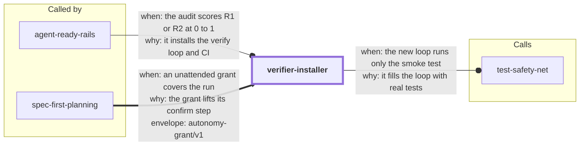

# verifier-installer

Stands up the **runnable-verifier loop** — one discoverable command each for
format, build, and test, plus a CI workflow that runs the same commands — in a
repository that lacks it.

This is the action-taking sibling of
[`agent-ready-rails`](../agent-ready-rails/): rails *audits* a repo and, in
practice, its #1 finding is a missing or partial verify loop (the load-bearing
R1/R2 rails). This skill turns that finding into files: it detects the stack,
proposes a plan, installs the missing verifiers and a GitHub Actions workflow,
and then **proves the loop** by intentionally breaking something trivial,
watching the verifier go red, and reverting to green — verify-and-repair
demonstrated, not assumed.

**Not** a linter-config generator for style debates, and **not** for repos
whose verify+CI loop is already green (agent-ready-rails will tell you so).

<!-- skill-graph:start -->
## Where it fits

<!-- Generated by scripts/gates/skill_graph.py from docs/skill-graph/graph.json. Do not edit this block by hand: edit the JSON, then run `make skill-graph`. -->

**Usually called by** `agent-ready-rails` and `spec-first-planning`. You can also start it yourself when a repo has no runnable verify loop or CI.



An arrow from A to B means A sends work or data to B. `==>` contract envelope, `-->` required, `--o` handoff (you start the next skill), `-.->` optional (only when installed). The map of all skills is in the [root README](../README.md#how-the-skills-fit-together).
<!-- skill-graph:end -->

## Install

```bash
npx skills add dhanesh/agent-skills --skill verifier-installer
```

No further setup: detection is offline, stdlib-only python3. The target repo's
own toolchain (npm, go, cargo, pytest, make) is only needed to actually run
the verifiers it implies.

## Usage

Ask the agent to "set up the verify loop / tests / CI for this repo", or run
the detector directly:

```bash
python3 assets/detect_stack.py /path/to/repo
```

It emits a deterministic JSON plan:

```json
{
  "stacks": ["node"],
  "existing_verifiers": {"build": "npm run build", "ci": null, "format": null, "test": "npm test"},
  "missing": ["ci", "format"],
  "proposals": [
    {"rail": "ci", "command": "push a branch / open a PR — the workflow runs the other rails", "file_to_create": ".github/workflows/verify.yml"},
    {"rail": "format", "command": "npm run format", "file_to_create": "package.json"}
  ],
  "lockfiles": ["package-lock.json"],
  "errors": []
}
```

The agent then confirms the plan with you, installs per the per-stack
playbooks in [`references/install-playbooks.md`](references/install-playbooks.md),
runs each installed command, demonstrates a red→green cycle, and hands back a
summary listing every rail with the command that exercises it.

Detected stacks: python (pyproject/setup/requirements, pytest vs unittest),
node (package.json scripts + lockfiles, npm-placeholder-aware), go, rust, and
Makefile targets — plus existing `.github/workflows/` CI, so it never installs
a duplicate workflow. Malformed manifests are reported in the plan's `errors`
list instead of crashing. Python's format rail proposes a real `ruff`/`black`
check only when the repo structurally adopts one (a config section, config
file, pre-commit hook, or pinned dependency — never a bare word match), and
otherwise falls back to a loudly-failing placeholder that the plan marks
`"placeholder": true` so it's never mistaken for a proven rail.

## Testing

```bash
cd assets && python3 test_detect_stack.py   # unit suite (stdlib, offline)
python3 eval/run_eval.py                    # outcome eval incl. negative fixtures
make gate-skill SKILL=verifier-installer    # full repo gate, from repo root
```

See [`SKILL.md`](SKILL.md) for the agent-facing workflow.
